# phoneME FunKey J2ME Runtime

> If a specific game doesn't work, reach out on Telegram: [@slrmo0n](https://t.me/slrmo0n)

A `phoneME`-based Java ME runtime and `OPK` wrapper for `FunKey S / RG Nano`.

Based on the upstream phoneME-GP2X-SDL source at:  
<https://github.com/j2me-preservation/phoneME-GP2X-SDL>

## Screenshots

### Launcher

<p float="left">
  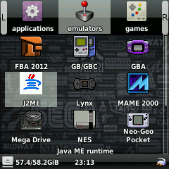
  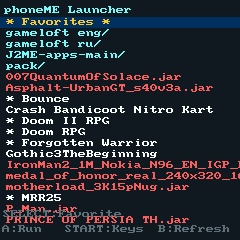
  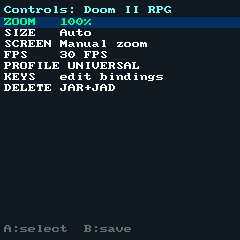
  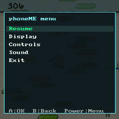
</p>

### Games

<p float="left">
  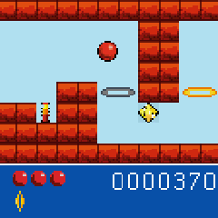
  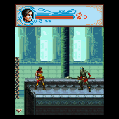
  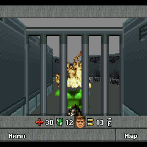
</p>

## Installation

1. Download `pm.opk` from the [latest release](https://github.com/slrmoon/j2me-funkey-rgnano/releases/latest)
2. Place it in the `emulators` folder on your FunKey/RG Nano SD card
3. Create a `java` folder in the root of the SD card
4. Put your `.jar` files into that `java/` folder
5. Japanese i-mode games (**i-appli**, NTT DoCoMo DoJa) go into the same
   `java/` folder: keep the `.jam` next to the `.jar` (same name, or the only
   `.jam` in its folder), optionally with the `.sp` scratchpad. They show up
   in the list with an `i` mark. See [i-mode games (i-appli)](#i-mode-games-i-appli).

## Features

- **MIDP 2.0 / CLDC 1.1** runtime (phoneME) with a game browser launcher.
- **i-mode games (i-appli)** for NTT DoCoMo phones (DoJa profile) run from
  the same launcher next to the MIDP games, with i-mode MLD music on a
  Yamaha MA-3 FM synthesizer. See [i-mode games (i-appli)](#i-mode-games-i-appli).
- **3D: JSR 184 (M3G)** on a software OpenGL ES 1.x renderer written for the
  FunKey (single Cortex-A7, RGB565): integer rasterizer with a NEON span
  loop, texture cache, fog, lighting, sprites, render-to-texture.
  See [3D (M3G)](#3d-m3g).
- **Sound: MMAPI (JSR 135)** on a new audio engine with the handset MIDI synth
  (Sonivox EAS), all common phone formats and the vendor sound APIs.
  See [Sound](#sound).
- **Scaling** for every phone resolution, with sharp / smooth filtering and a
  movable view for cropped modes. See [Scaling](#scaling).
- **In-game menu** (Power button) that freezes the game while open.
- **Debug options** in the launcher and the in-game menu: log file, detailed
  logs, FPS counter, CPU profiler and an on-device log viewer.
  See [Debugging](#debugging).

## In-game menu

Press **Power** during a game. The game and its sound are **frozen** while
the menu is open and continue exactly where they were when it closes. The
menu is translucent, so the frozen picture stays visible behind it.

| Page | What is there |
|---|---|
| **Resume** | back to the game |
| **Display** | Screen, Zoom, Size, Filter, FPS, Adjust view — see [Scaling](#scaling) |
| **Controls** | key profile and per-button bindings |
| **Sound** | Volume, MIDI synth — see [Sound](#sound) |
| **Debug** | log switches and FPS counter — see [Debugging](#debugging) |
| **Restart game** | quit and start the game again (applies a new Size and debug settings) |
| **Exit** | save and quit to the launcher |

D-pad moves and changes values, **A** selects, **B** goes back.
All settings are saved **per game** (`/mnt/FunKey/.pm/keybinds/<game>.cfg`)
and are also available from the launcher: press **START** on a game.

## Scaling

The FunKey screen is 240×240. J2ME games were made for many phone screens,
so the picture usually has to be scaled, cropped or both.

### 1. Size — the game's own resolution

Pick the screen size the game was made for. Everything else depends on it.
**Restart the game after changing it** (in-game menu → **Restart game**).

| Size | Typical phones |
|---|---|
| Auto | let the runtime guess from what the game draws |
| 128×128 | very old Nokia / Siemens |
| 128×160 | old Samsung / LG / Motorola |
| 176×208 | Nokia S60 |
| 176×220 | Sony Ericsson, Siemens, most "middle" phones |
| 208×208 | Nokia S60 square |
| Tall 240×320 | most later portrait phones |
| Wide 320×240 | landscape phones / games |
| Full buffer | the whole drawing buffer, no detection |

If the picture is stretched, cut off, too small or the UI is outside the
screen, the size is most likely wrong.

### 2. Screen — how the picture is placed

| Screen | What it does | Use it for |
|---|---|---|
| **Auto** | Picks one of the modes below by a rule (see next table) | a good default |
| **Fit all** | whole picture, proportions kept, black bars | text, HUD and menus must be fully visible |
| **Crop fill** | fills the screen, proportions kept, edges cut off | bars bother you; move the view with *Adjust view* |
| **Stretch** | forced 240×240, proportions lost | last resort |
| **Center** | 1:1, no scaling; larger games are cut, smaller get bars | games close to 240×240 |
| **Manual zoom** | your own zoom factor (see *Zoom*), around the area the game actually draws | fine tuning (launcher default) |
| **Integer** | largest whole multiple that fits (2×, 3×…), else 1:1 | perfectly even pixels for small games (≤120 px) |

**Auto** decides like this:

| Game size | Auto result |
|---|---|
| 240×240 | 1:1 |
| ≤ 120 px (a whole multiple fills ≥ 90% of the screen) | Integer |
| filling the screen cuts ≤ 16% of the picture (128×128, 176×208, 208×208) | Crop fill |
| anything else (176×220, 128×160, 240×320, 320×240) | Fit all |

### 3. Zoom

Only for **Manual zoom**. The presets depend on *Size* (for example
150–200% for 128×128, 100–120% for 176×208, "Safe 70%" … "Full width" for
240×320). In other modes the menu shows a hint that Zoom does nothing.

### 4. Filter — how pixels are scaled

| Filter | Look | Notes |
|---|---|---|
| **Sharp** (default) | crisp pixels of even width | at non-integer factors (e.g. 176→240 = 1.36×) each game pixel stays a clean block, only its edge is blended over one screen pixel — no "uneven pixel" shimmer when scrolling |
| **Smooth** | soft, bilinear | photos / pre-rendered art; text gets softer |
| **Pixel** | plain nearest neighbour (the old behaviour) | uneven pixel widths, lines may disappear when shrinking |

When the picture is **shrunk** (240×320 → 180×240), Sharp and Smooth average
the source pixels, so thin lines and small text are kept instead of dropped.

### 5. Adjust view — move the picture when it is cropped

In every mode that cuts something off (Crop fill, Auto when it crops,
Center/Integer with big games, Manual zoom) you can choose which part is
visible — for example to bring back a score line or soft-key labels.

Display → **Adjust view** shows the frozen game full screen with a hint bar:

- **D-pad** — move the picture (10% steps)
- **L1 / R1** — zoom in Manual zoom mode
- **B** — back to the center
- **A** (or Power) — done, the position is saved for this game

If the whole picture already fits, the hint says *"Whole picture fits:
nothing to move"*.

### 6. FPS

Frame limit (Off / 20 / 25 / 30 / 50 / 60). 30 is the default.

Most phone games keep their own pace (they measure time), but some simple
ones move one step per frame and were tuned for 15–20 FPS handsets: without
a limit they run too fast. The limit pauses the whole game, not just the
picture, so such games keep their normal speed.

- Game too fast → 20 or 25.
- Game keeps its own pace (speed does not change with the limit) → 30 or Off.

Frames are released on a fixed 1/FPS schedule: a slow frame is made up by
the following fast ones, so a game that can reach the limit really gets it
even when frames are uneven (typical for 3D). A lower limit does not make a
slow game faster.

### Quick recipes

| Game | Size | Screen | Filter |
|---|---|---|---|
| Nokia S40 128×128 | 128×128 | Auto / Crop fill | Sharp |
| S60 176×208 | 176×208 | Auto (crop) + Adjust view if the soft-key line is cut | Sharp |
| Sony Ericsson 176×220 | 176×220 | Auto (fit) or Crop fill + Adjust view | Sharp |
| Portrait 240×320 | Tall 240×320 | Fit all for menus/text, Crop fill + Adjust view for action | Sharp |
| Landscape 320×240 | Wide 320×240 | Fit all | Sharp |

## Sound

Sound is played by **fkaudio**, a small engine written for this device:
one 22 kHz mono mixer (the FunKey has one speaker), its own parsers for
every phone music format, and the **Sonivox EAS** synthesizer — the MIDI
engine that shipped on many handsets and in Android — for the authentic
phone sound.

**Formats** (detected from the data; the content type a game declares is
only a hint, games often get it wrong):

| Kind | Formats |
|---|---|
| Music | MIDI (SMF 0/1/2, RMID), SMAF / MMF (Yamaha, incl. ADPCM voices), iMelody, Nokia OTA / Smart Messaging, RTTTL, JSR 135 tone sequences, i-mode MLD (Yamaha MA-3 FM synth) |
| Sampled | WAV (8/16/24/32-bit, float, A-law, µ-law, IMA and MS ADPCM), AU, AMR-NB, MP3 |

**APIs**: MMAPI 1.1 (`Manager`, `Player`, `PlayerListener`, Volume / MIDI /
Tempo / Rate / Pitch / StopTime / Tone controls, `Manager.playTone`,
`device://tone`, `device://midi`) and the vendor APIs: Nokia
`com.nokia.mid.sound.Sound`, Samsung `com.samsung.util.AudioClip`, Siemens
`com.siemens.mp.game.Sound / Melody / MelodyComposer` and
`com.siemens.mp.media`, Motorola `com.motorola.midi.MidiPlayer`.

Playback details: instant start (nothing is pre-rendered), exact seeking,
gapless loops (also for MP3), many sounds at once, a soft limiter instead
of clipping.

**In-game menu → Sound**

- **Volume** — 0–100%.
- **MIDI synth** — the instrument set, applied immediately:
  - **Hybrid** (default) — FM + small wavetable at 22 kHz, the typical phone sound
  - **Wavetable** — sampled instruments, fuller
  - **FM** — pure FM, the oldest phones

Advanced (environment variables in `r.sh`):

| Variable | Meaning |
|---|---|
| `PHONEME_SYNTH` | `hybrid` / `wavetable` / `fm` (normally set from the menu) |
| `PHONEME_SOUNDBANK` | path to your own DLS or SF2 bank; `lib/soundbank.dls` / `.sf2` in the runtime folder is picked up automatically |
| `PHONEME_MIDI_GAIN` | MIDI loudness, 50–100 (default 90) |
| `PHONEME_AUDIO_BUFFER` | output buffer in samples (default 1024 ≈ 46 ms); lower = less latency, more risk of crackles |
| `PHONEME_AUDIO_TRACE` | print the audio device setup to the log |

## i-mode games (i-appli)

i-appli are the Java games of Japanese NTT DoCoMo i-mode phones (2001-2010s),
written for the DoJa profile (`com.nttdocomo.*`) instead of MIDP. A game is a
`.jar` plus a `.jam` descriptor (Shift-JIS text with `AppClass`, `DrawArea`,
`SPsize`...) and often a `.sp` scratchpad with its data.

- **Install:** put the `.jar`, `.jam` and (if you have it) `.sp` into `java/`.
  A `.jar` counts as i-appli when its `.jam` has the same name or is the only
  `.jam` in the folder and its `AppClass` is in the jar. The game reads and
  saves its scratchpad in place (`<game>.sp` next to the `.jar`, created when
  missing); nothing is copied elsewhere.
- **Screen:** the game's `DrawArea` (240x240 when missing) becomes the screen
  size, the usual scaling options apply. Keys use the `doja` profile
  (D-pad, A = select, soft keys, 0-9, `*`, `#`).
- **Runtime:** DoJa 1.x-5.x UI (Canvas with lock/unlock, Graphics incl.
  `opt.ui` render modes, Panel and components, Dialog, Sprite, ShortTimer),
  MediaManager images (GIF/PNG/JPEG), scratchpad, `JarInflater`, Shift-JIS
  text with Japanese bitmap fonts (Shinonome).
- **Sound:** i-mode **MLD** melodies are played by a C port of the Keitai Wiki
  MLD sequencer and Yamaha MA-3 FM synthesizer, with the fixes from openDoJa
  (presets, timing, repeats, cue-point loops, vibrato). By default it runs in a
  fast mode (half the chip rate, 16 voices) to keep the music in real time on
  the FunKey; `PHONEME_MLD_EXACT=1` gives the bit-exact output. SMAF, MIDI and
  WAV sounds go through the normal audio engine.
- **Tested:** Rockman The Puzzle Battle (CAPCOM, 2011) — loading, menus,
  gameplay, music; DoJa-1942 (homebrew).
- **Not yet:** MascotCapsule 3D (`opt.ui.j3d`), ADPCM voice samples inside MLD,
  network (`HttpConnection`), text input (IME returns the initial text).
  Unimplemented calls are logged as `DoJa: unimplemented ...`.

Details and progress: [`DOJA_STATUS.md`](DOJA_STATUS.md).

## 3D (M3G)

JSR 184 games run on a software renderer made for this device (no GPU):
the Nokia M3G core on a custom OpenGL ES 1.x rasterizer that draws straight
into the 16-bit screen buffer. It supports textures (with a per-image cache
and mipmaps), lighting, fog, sprites, alpha blending, depth test, culling,
`.m3g` files, animation and rendering into images. Native objects are
released when the game drops them (finalizers), so long sessions do not
run out of memory.

Speed. The FunKey has one Cortex-A7 core and no GPU, so every pixel is
drawn by the CPU. The renderer is tuned for that:

- a span fast path for the common states (one nearest texture,
  replace/modulate, alpha blending, depth test), with a NEON loop that
  draws 4 pixels at a time;
- vertex cache, combined model-view-projection per draw, clip codes per
  vertex, off-screen triangles rejected early;
- built for Cortex-A7 (`-march=armv7ve -mcpu=cortex-a7 -mfpu=neon-vfpv4`,
  hardware divide).

In Rally Master Pro (240×320) these changes raised the frame rate in races
by about 1.5–2×. Heavy scenes are still CPU-bound: if a game is slow, use the
*Pixel* filter (cheapest scaling) and send a [profiler](#profiler-output)
report.

## Repository structure

This export is split into two parts:

- `phoneme-funkey-clean`
  Cleaned runtime source tree with FunKey-specific build scripts.
- `phoneme-funkey-opk-wrapper`
  `OPK` packaging layer, launcher, icon and JAR/JAD wrapper logic.

Intentionally not included:

- `FunKey-sdk-2.3.0`
- `Zulu JDK 7`
- `build_output*`
- `.toolchains`
- prebuilt `OPK` files
- local test JARs and older backup/dev folders

## Required dependency versions

1. FunKey SDK
   Version: `2.3.0`
   Official docs: <https://doc.funkey-project.com/developer_guide/tutorials/build_system/build_program_using_sdk/>
   Release download used by this project:
   `https://github.com/FunKey-Project/FunKey-OS/releases/download/FunKey-OS-2.3.0/FunKey-sdk-2.3.0.tar.gz`

2. JDK
   Version: `Azul Zulu JDK 7`
   Exact archive used by this project:
   `zulu7.24.0.1-ca-jdk7.0.191-linux_x64.tar.gz`
   Archive index:
   <https://cdn.azul.com/zulu/bin/zulu>
   Direct download:
   `https://cdn.azul.com/zulu/bin/zulu7.24.0.1-ca-jdk7.0.191-linux_x64.tar.gz`

## Host build requirements

Confirmed working on **Ubuntu 26** (amd64 host).

- `bash`
- `make`
- `gcc`
- `g++`
- `find`
- `sed`
- `grep`
- `file`
- `mksquashfs`
- `gcc-multilib`
- `g++-multilib`
- `libc6-dev-i386`

## Expected layout

```text
repo/
  phoneme-funkey-clean/
  phoneme-funkey-opk-wrapper/
```

Recommended approach: keep the SDK and JDK outside the repository and pass them explicitly via env vars.

If you prefer local unpacked copies, these are the paths the scripts know how to use by default:

- `phoneme-funkey-clean/FunKey-sdk-2.3.0`
- `phoneme-funkey-clean/zulu7.24.0.1-ca-jdk7.0.191-linux_x64`
- `phoneme-funkey-clean/zulu7.24.0.1-jdk7.0.191-linux_x64`

## Build runtime

```bash
cd phoneme-funkey-clean
JDK_DIR=/path/to/zulu7.24.0.1-ca-jdk7.0.191-linux_x64 \
FUNKEY_SDK_DIR=/path/to/FunKey-sdk-2.3.0 \
./build-funkey-s.sh
```

Compiler flags are not tracked by make: after changing `ARM_CFLAGS` (or
pulling a commit that changes them in `build-funkey-s.sh`) delete
`phoneME-GP2X-SDL/phoneme_feature/build_output_funkey_s` and build again.

Main runtime outputs:

- `phoneme-funkey-clean/phoneME-GP2X-SDL/phoneme_feature/build_output_funkey_s/midp/bin/arm/runMidlet`
- `phoneme-funkey-clean/phoneME-GP2X-SDL/phoneme_feature/build_output_funkey_s/cldc/linux_arm_vfp/dist/bin/cldc_vm`

## Build OPK (launcher)

The wrapper builds a self-contained `pm.opk` with the full runtime, SDL launcher, desktop entry and icon.

**Launcher build** (no external JAR required):
If no MIDlet is passed, the script still builds the launcher `OPK`. In that mode it also bundles a tiny built-in `HelloMidlet` as a fallback/test MIDlet inside the package, but the main user-facing entry point is still the SDL launcher.

```bash
cd phoneme-funkey-opk-wrapper
FUNKEY_PHONEME_ROOT=../phoneme-funkey-clean/phoneME-GP2X-SDL \
JDK_DIR=/path/to/zulu7.24.0.1-ca-jdk7.0.191-linux_x64 \
FUNKEY_SDK_DIR=/path/to/FunKey-sdk-2.3.0 \
./package-funkey-opk.sh
```

**With your own bundled MIDlet:**

```bash
cd phoneme-funkey-opk-wrapper
FUNKEY_PHONEME_ROOT=../phoneme-funkey-clean/phoneME-GP2X-SDL \
JDK_DIR=/path/to/zulu7.24.0.1-ca-jdk7.0.191-linux_x64 \
FUNKEY_SDK_DIR=/path/to/FunKey-sdk-2.3.0 \
./package-funkey-opk.sh /path/to/game.jar
```

If the JAD is separate, pass it as second argument.  
Set `FUNKEY_MIDLET_MAIN` to specify the main class explicitly.

Result: `phoneme-funkey-clean/phoneME-GP2X-SDL/phoneme_feature/build_output_funkey_s/opk/pm.opk`

## Known issues

- **Controls** — button mapping is still incomplete on FunKey S / RG Nano; some games may need a different key profile (in-game menu → Controls, or `PHONEME_KEY_PROFILE` in `r.sh`).
- **3D speed** — complex M3G scenes are still CPU-bound on the single
  Cortex-A7 (no GPU). Games that use filtered or mipmapped textures take the
  slower general path. Perspective is corrected every 16 pixels, which can
  bend textures slightly on large surfaces seen at a steep angle.
- **Not supported**: Motorola `com.motorola.game` (GameScreen API), Mobile XMF music, video, camera/recording.

## Debugging

Debug options are **global** (the same for every game) and stored in
`/mnt/FunKey/.pm/debug.cfg`. The launcher and the in-game menu edit the same
file.

### In the launcher — press **Y**

<p float="left">
  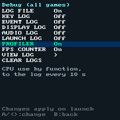
  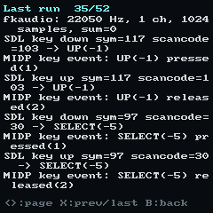
</p>

**Left — Debug screen.** A or ◀▶ toggles an option; the two lines below the
list explain the selected one.

| Option | Default | What it writes |
|---|---|---|
| **Log file** | On | game output to `.pm/runmidlet.log`; the run before is kept as `runmidlet.prev.log`. Off: nothing is written to the SD card |
| **Key log** | Off | every button press and the phone key it maps to |
| **Event log** | Off | key events delivered to the game |
| **Display log** | Off | screen set-up and the chosen scaling layout |
| **Audio log** | Off | audio device rate, channels and buffer |
| **Launch log** | Off | all settings the launcher passes to the game |
| **Profiler** | Off | every 10 s: CPU load, time per area (Java, 3D, 2D, display, audio, GC…) and the top functions / Java methods — see below |
| **FPS counter** | Off | frames per second on screen (no log needed) |

The logs need **Log file** on; otherwise they show as `On (no log)`.
**Clear logs** deletes both log files.

**Right — View log**: the log of the last run, read on the device, opened at
the end. D-pad scrolls, ◀▶ by page, **L1/R1** jump to the start/end,
**X** switches to the previous run.

### Profiler output

With **Profiler** and **Log file** on, the log gets a report every 10 seconds:

```text
[profile] 10.0 s, CPU 97%, 980 samples
[profile] by area: Java (JIT) 41%, 3D (M3G) 27%, display output 9%, audio 8%, ...
[profile]  12.3%  ngl_sw_raster_tri_fast
[profile]   6.1%  e.a
...
```

`CPU` is how busy the processor was; the areas and the list below show where
that time went. Java methods appear as `class.method` (obfuscated names in most
games). Send this report when a game is slow — it shows what to optimize.

### In a game — Power → **Debug**

<p float="left">
  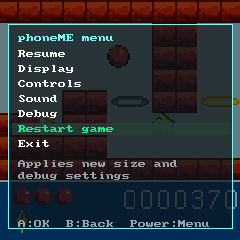
  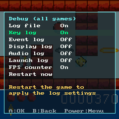
  
</p>

**Left — Restart game** (main menu) quits and starts the game again with the
saved settings. Use it after changing the logs or **Size**.

**Middle — Debug page**: the same options as in the launcher. The log
options are read when the game starts, so the yellow reminder stays until you
restart (the **Restart now** row does it from here).

**Right — FPS counter**: switches on and off right away, no restart needed.
It shows how many frames the game draws per second, after the FPS limit.

## Third-party components

| Component | License | Used for |
|---|---|---|
| [Sonivox EAS](https://github.com/pedrolcl/sonivox) | Apache 2.0 | MIDI synthesizer |
| [minimp3](https://github.com/lieff/minimp3) | CC0 | MP3 decoding |
| Keitai Wiki MLD / MA-3 music implementation (Guy Perfect, SquirrelJME) | Unlicense / MPL 2.0 | MLD sequencer and MA-3 FM synth (C port) |
| fdlibm 5.3 | Sun (free use with notice) | log/pow in the MLD synth |
| Shinonome bitmap fonts | Public domain | DoJa Japanese text |
| opencore-amr | Apache 2.0 | AMR-NB decoding |
| Nokia M3G core (from phoneME) | EPL 1.0 | 3D scene graph |
